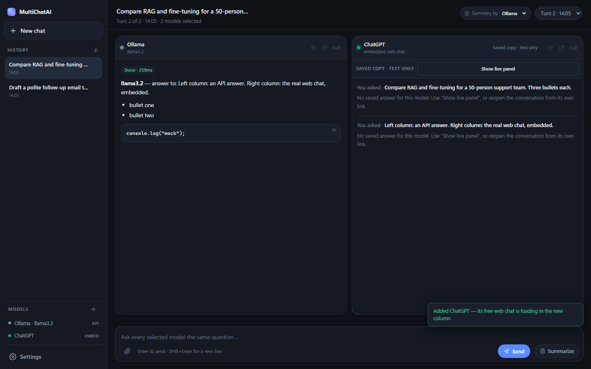

# MultiChatAI



A Microsoft Edge (Chromium) extension that sends **one prompt to several AI models at
once** and shows every answer **side by side in a single window**.

- **No API key needed by default.** Each column runs that model's **own free web chat,
  embedded inside the column** — the site you already use, in your own window.
- Ask once → ChatGPT, Gemini, Claude, DeepSeek, Grok (and more) answer in parallel.
- Conversations are saved locally with a topic name and timestamp; click one in the
  sidebar to bring the comparison back.
- **Summarize** has one chosen model read every answer and write the comparison: the points
  **every model makes**, a table of **where they differ** (one row per item, one column per
  model) and a link to each model's own chat ([screenshot](docs/screenshot-summary.png)). The
  summarising model is a tag in the top bar — the first column by default.
- Two alternative connections per model: an **API key** (direct calls, no page at all) or an
  **existing tab** you keep open.
- Multi-window safe: changing the model list in one window updates the others instantly.

---

## Install (unpacked, for development / personal use)

1. Open `edge://extensions`.
2. Turn on **Developer mode** (bottom-left).
3. Click **Load unpacked** and select the `extension` folder of this repository
   (the folder that contains `manifest.json`).
4. Pin **MultiChatAI** to the toolbar. Clicking the icon (or <kbd>Alt</kbd>+<kbd>Shift</kbd>+<kbd>M</kbd>)
   opens the chat window in a tab. Existing tabs are reused instead of piling up.

The extension needs no build step — the folder is the extension.

## First run

1. With no models configured, the left sidebar opens on **Settings → Models**.
2. Pick a provider (ChatGPT, Gemini, Claude, DeepSeek, Grok…) and press **Add model**.
   The default connection is **Embedded web chat** — the provider's real page loads inside
   that column, free, with no key. Add as many providers as you want.
3. Sign in inside each column once (or press **Open in tab**, sign in there, then ⟳ to
   reload the panel). The login is remembered by your browser.
4. Type a question, press **Send** — the prompt is typed into every column and sent.

## What you get

| Requirement | Where it lives |
| --- | --- |
| Chat window like any AI app, opened from the toolbar | Toolbar click → `src/app/app.html` |
| Left sidebar: **New chat** at the top | Sidebar button, clears the board and starts a fresh turn list |
| **History** with topic name + timestamp, click to restore | Reopens the conversation with its contents: API/tab columns re-render their answers, embedded columns show the **saved transcript** ([screenshot](docs/screenshot-history.png)) |
| Continue an old topic | Type below and Send — embedded panels reopen the live page and are handed a short recap of the conversation, so the model continues rather than restarts |
| Settings + models live **inside the left sidebar** | The sidebar swaps to the settings panel (`Models / General / About`) and widens; ← returns |
| **Models** is the first subsection | Settings button at the very bottom, panel opens on Models |
| Dropdown of major providers | Five majors first, five more below |
| A new model becomes a column immediately (first one above the input box) | Board reconciles in place — no tab, no reload |
| **Free web chat embedded in each column** | `<iframe>` per column + scoped `declarativeNetRequest` header rules |
| Columns all the same width | `flex: 1 1 0` — equal shares, independent of content |
| Remove a model with **×** | `×` on every card; its column disappears at once, the rest widen; nothing else re-renders |
| No models left → input blocked | “Please add a model” panel above a disabled input box |
| Same prompt to all selected models | One run, N parallel adapters |
| **Summary by** tag in the top bar: one model writes the comparison | `#summarize-model` chip + `src/app/summary-request.js`, asked through the normal run pipeline |

## The three connection modes

**1. Embedded web chat — default, free, no key.**
The provider's own page is framed inside the column. Provider sites normally refuse this
(`X-Frame-Options`, `Content-Security-Policy: frame-ancestors`), so the extension removes
exactly those two headers with `declarativeNetRequest`. The rule is **scoped**: it only
applies to requests initiated by this extension (`initiatorDomains: [chrome.runtime.id]`),
which means websites embedding the same provider are still blocked — the protection is not
weakened for anyone else. Verified by `scripts/probe-embed.mjs` and `scripts/embed-test.mjs`.

The prompt is typed into that frame by a content-script bridge (`src/content/bridge.js`) and
submitted; the answer streams back for status/history while you watch the real page.

**2. API key — no page at all.**
Direct HTTP calls from the service worker (`src/background/api.js`), streamed token by
token. Stable, exact, supports images, billed by the provider.

**3. Existing tab.**
Drives a provider tab you have already opened. MultiChatAI never creates one.

```
                 ┌─────────────────────────────────────────────┐
 toolbar click ─▶│ app.html   chat window                      │
                 │  ┌─ column ─────────┐ ┌─ column ──────────┐ │
                 │  │ <iframe>         │ │ answer pane       │ │
                 │  │ chatgpt.com      │ │ (API mode)        │ │
                 │  └────────┬─────────┘ └─────────┬─────────┘ │
                 └───────────┼─────────────────────┼───────────┘
                     bridge │ (frame → worker)    │ port
                 ┌───────────▼─────────────────────▼───────────┐
                 │ service worker: fan-out, storage, fan-in     │
                 └───────────┬─────────────────────┬───────────┘
                     frameId │                     │ fetch /v1
                 ┌───────────▼─────────┐  ┌────────▼─────────────┐
                 │ provider page       │  │ provider HTTP APIs   │
                 │ (in the column)     │  │ (SSE streaming)      │
                 └─────────────────────┘  └──────────────────────┘
```

## Features in detail

- **Settings without leaving the window.** The sidebar swaps between the chat list and the
  settings panel; adding a model updates the board behind it instantly.
- **A model's connection can change later.** Every card in Settings → Models has a
  **Connection** dropdown (Embedded web chat / Existing tab / API key), so a model added in the
  wrong mode is fixed without deleting and re-adding it — and only that model's column is
  rebuilt. A column set to “existing tab” that has no tab to drive says so and offers
  **Open a … tab** and **Use the embedded panel** right inside the message.
- **Columns follow the model list.** Removing (or unchecking) a model drops its column
  immediately and **in place** — the other columns keep their answers and scroll position
  and simply get wider.
- **History reopens the model's own conversation.** Every answer stores the model's own link to
  that chat (chatgpt.com/c/…, claude.ai/chat/…, …), so opening a topic loads that link and
  the provider re-renders exactly what it produced — graphs, tables, artifacts, images. It is a
  page load, which is the price of exactness (a framed site may ask you to sign in again).
  Turns without a recorded link fall back to the saved copy: the answer's rendered HTML replayed
  in a sandboxed frame, or its text if even that was not captured.
- **New chat: history kept, every column reloaded.** One click files the current conversation
  into the sidebar, empties the columns and **reloads every embedded panel at its provider's
  home URL**, so each model starts a genuinely fresh session. Reloading is deliberate: pressing
  a site's own “New chat” button was unreliable (providers disagree about that control, and a
  SPA could keep its old thread alive), while a reload cannot miss. Settings → General can turn
  the reload off if you prefer the panels to keep their conversation.
- **History never reloads a panel.** Opening an old topic paints the saved answer and leaves
  the embedded pages exactly as they are. Each answer also stores the model's own link to that
  chat, so the saved copy offers **Open in ChatGPT** when you do want the full page (charts,
  artifacts) and **Show live panel** to go back to the panel you already had.
- **Full view for one model.** Every column header has a **Full** button next to ↗: it widens
  that column to the whole board and turns into **Return** (Esc works too) to go back. It is a
  layout change only — the other columns and any embedded page stay loaded, nothing re-renders.
- **Summary written by a model you pick.** The top bar carries a **Summary by** tag — the
  first column by default, any model on the board by choice. Pressing **Summarize** (right of
  Send) hands that model every answer of the round and asks it for the structure the window
  shows: bullet points **every model makes**, then a table of **where they differ** — one row
  per item, one column per model — and the window appends the **link to each model's own
  chat**, which no model could know. The scope toggle switches between *this round* and *the
  whole chat*, **Copy** puts the result on the clipboard as Markdown, **Ask again** re-asks,
  and Esc goes back to the columns (which are only hidden behind the panel, never reloaded).
  The ask goes through the normal run pipeline: an API model answers in the service worker,
  while an embedded (or tab) model is asked **in its own chat**, so that thread will show the
  request — the panel says so while it waits. The finished summary is stored with its turn, so
  reopening it costs nothing; changing the model, the scope or pressing Ask again asks again.
- **No new tabs, ever.** Embedded columns are frames of the window you are looking at; API
  models do all their work in the service worker; “existing tab” models never create one.
  Only an explicit click (**Open in tab**) opens a browser tab.
- **Parallel fan-out.** Every model starts at the same moment; a slow one never blocks the rest.
- **Live streaming.** API models stream tokens; embedded models stream as the page renders
  them.
- **A run ends when each model is ready for the next question.** The column header says
  `Done`, `Answered in the panel` (the page answered but its text could not be read out) or
  `Stopped`, and the composer unlocks as soon as the last one settles. There is no “wait for
  the timeout” state, and the run also ends if the extension's background was restarted
  mid-answer.
- **Stop always works.** It aborts the run and settles every column that is still open; the
  partial text stays. Nothing about it depends on the background answering.
- **Multi-turn memory.** API models receive earlier turns; embedded models keep their own
  thread in their own page (and can be reset with “New chat”, Settings → General).
- **Attachments.** Text files are inlined; images go to vision-capable APIs, and are attached
  through the site's own file input in embedded/tab modes (best effort).
- **Themes.** Dark (default) and light.

## Privacy

- No MultiChatAI server, no analytics, no remote code.
- Conversations, settings and (only if you use API mode) keys live in
  `chrome.storage.local` on this machine. Keys are plain text in that store — they are never
  sent anywhere except the provider's API host.
- Embedded mode stores nothing about your login: the provider page runs in the frame with
  your browser's cookies, exactly as a normal tab would.
- The framing-header rules apply only to this extension's own frames.

Permissions, one by one:

| Permission | Why |
| --- | --- |
| `storage`, `unlimitedStorage` | conversations, settings, keys |
| `tabs` | find the provider tabs it may drive; open the app window |
| `scripting` | reload the bridge after an update |
| `declarativeNetRequest` | drop `X-Frame-Options`/`frame-ancestors` for this extension's own frames only |
| `host_permissions` (provider sites) | frame the provider page and drive it |
| `host_permissions` (API hosts) | call the provider APIs without CORS errors |

## Tests

```bash
node scripts/validate.mjs        # manifest, paths, syntax, CSP, icons
node scripts/smoke-test.mjs      # boots the UI in headless Edge (16 checks, offline)
node scripts/e2e-test.mjs        # mock provider round trip (56 checks, offline)
node scripts/embed-test.mjs      # real provider framed inside a column (23 checks, needs internet)
node scripts/test-completion.mjs # bridge: when is the page ready again? (12 cases, offline)
node scripts/test-run-policy.mjs # app: readiness settle + deadlines (13 cases, offline)
node scripts/test-providers.mjs  # provider chat-link patterns (21 cases, offline)
node scripts/test-summary.mjs    # the prompt that asks a model to summarise (16 cases, offline)
node scripts/probe-embed.mjs     # proves the framing/header technique (3 scenarios)
node scripts/diagnose-provider.mjs deepseek grok   # inspect a provider's framed page
node scripts/screenshot.mjs      # regenerates the images in docs/
```

Everything is dependency-free (Node ≥ 20 for the tests, Pillow only for icons). See
[docs/TESTING.md](docs/TESTING.md).

## Known limitations

- **Sites can fight back.** Beyond framing headers, two things can still block a panel and
  the extension cannot fix them from the inside:
  - **CDN/WAF rejecting framed requests** — measured: `chat.deepseek.com` answers
    `403 Request blocked` (CloudFront) when loaded in a frame, headers or not. The column
    detects it, says “Not usable here”, and offers **Use a tab instead** (one click) or an
    API key.
  - **WebSocket / network policy** — Grok needs a real-time connection to `grok.com`. If the
    network (proxy, firewall, “security software”) blocks it, Grok says so in the panel and
    no extension can bypass that; the same message appears in a normal tab.
- **Sign-in inside a panel.** Browser SSO (e.g. “Continue with Google”) cannot run inside a
  frame. Press **Open in tab**, sign in there, then ⟳ the panel — the cookie applies. Some
  browsers will require third-party cookies to be allowed for the provider domain.
- **The summary costs one request — to the model you picked.** It is that model's own answer,
  so it keeps its style and its mistakes; it also cannot know the chat links, which is why the
  window appends them. With an embedded or tab model the request is typed into that model's
  own chat, so the thread there will show it.
- **Heavy pages.** Each embedded column is a full web app; 4–5 columns use noticeable memory.
- **Site redesigns.** Browser-session adapters (embedded or tab) depend on the site's DOM;
  API mode is immune. Selectors live in `src/content/site-adapters.js`.
- **Ollama / local LLMs** work through the API path on `http://localhost:11434`.

## Troubleshooting

| Symptom | Fix |
| --- | --- |
| Column shows a provider “Log in” page | Sign in inside the panel, or **Open in tab** → sign in → ⟳ |
| Column says “Sign in inside this panel” | Same as above |
| Column says “Not usable here” | That provider refuses to be framed (DeepSeek's CDN does). Click **Use a tab instead** — one click switches the model to tab mode and opens the site — or use an API key |
| “This page did not load inside the panel” | Press **⟳** in the column; if it persists, use **Use a tab instead** |
| Grok: “your network or security software is blocking Grok's real-time connection” | Grok needs a WebSocket to grok.com. Test grok.com in a normal tab: same text ⇒ your network blocks it (nothing an extension can do); works in a tab ⇒ switch that model to **Use a tab instead** |
| Column says “No ChatGPT tab is open” | That model is in “existing tab” mode. Press **Use the embedded panel** right in that column (or **Open a ChatGPT tab** to keep a tab), or change *Settings → Models → Connection* — no need to remove and re-add the model |
| “No API key saved for …” | Settings → Models → paste key → Save key → Test |
| API error 401/403 / 404 | Key invalid / model name wrong for your account |
| Nothing appears in a column | Reload the panel with ⟳, then reload the extension |

## Layout

```
MultiChatAI/
├─ extension/                     ← load this folder as the extension
│  ├─ manifest.json               MV3 manifest
│  ├─ assets/icons/               16/32/48/128 px icons
│  └─ src/
│     ├─ app/                     the chat window (HTML/CSS/ES modules)
│     │  ├─ app.html  app.css  app.js
│     │  ├─ state.js  util.js  markdown.js  summary-request.js
│     │  └─ views/ sidebar.js  columns.js  settings.js
│     ├─ background/              service worker + adapters
│     │  ├─ service-worker.js  api.js  web-runner.js  bridge-hub.js
│     │  └─ embed-rules.js        scoped framing-header rules
│     ├─ content/                 provider bridge (classic scripts)
│     │  ├─ site-adapters.js  bridge.js
│     └─ shared/providers.js      provider catalogue (single source of truth)
├─ scripts/                       validation, tests, icons, packaging
├─ docs/                          architecture, providers, testing, screenshots
└─ dist/                          zipped builds (scripts/package.ps1)
```

More reading: [docs/ARCHITECTURE.md](docs/ARCHITECTURE.md) ·
[docs/PROVIDERS.md](docs/PROVIDERS.md) · [docs/TESTING.md](docs/TESTING.md)
